# SecretVault

**Offline, encrypted password manager for Windows.** Your passwords, notes, payment cards and personal
details live in one encrypted file on your PC — no cloud, no account, no server.

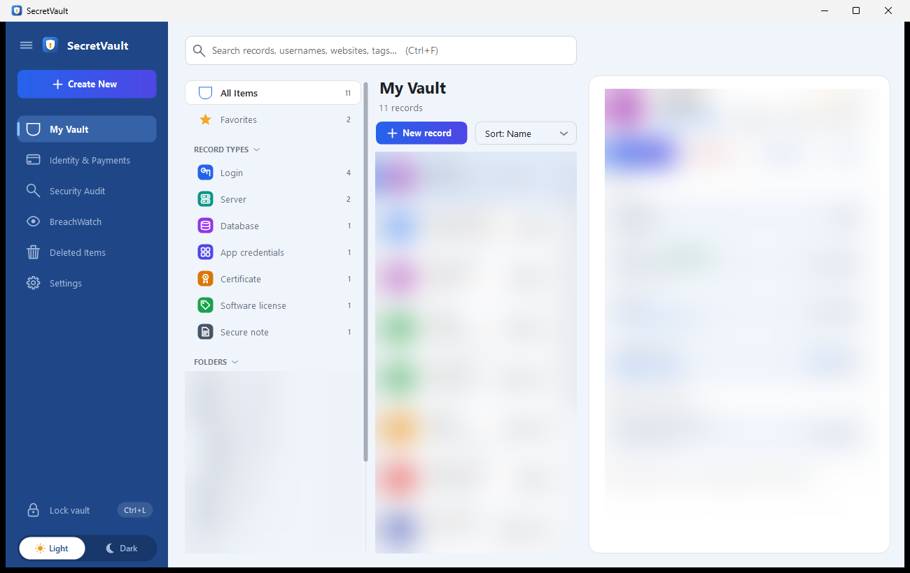

> Screenshots use sample data with record details blurred.

---

## Features

**Vault**
- Records with username, password, website, one-time (TOTP) codes, notes, tags and custom fields
- Folder tree (`Work\Servers` nests under `Work`), favourites, tags and **record types** (Login, Server,
  Database, App credentials, Certificate, Software license, Secure note) — detected automatically
- **New record** button above the list; new records go straight into the selected folder (and record type)
- Folders: create, nest, rename and delete (empty folders) from the folder's **+** button or right-click menu
- Move records with drag and drop onto a folder, the **Move** button, or right-click › Move to folder —
  a searchable folder picker instead of a long dropdown
- Right-click menus on records, folders and the empty list area (edit, favourite, copy, open site, delete)
- Search across names, usernames, websites, tags and notes
- Click any field to copy it; copies are kept out of Windows clipboard history and cleared after 5 minutes
- Password history (last 10 per record), Deleted Items with restore, website icons

**Security**
- AES-256-GCM encryption with an Argon2id-derived key (64 MB, 4 passes)
- Unlock with the master password, **Windows Hello** (fingerprint / face / PIN) or your **Windows password**
- **Recovery key** to reset a forgotten master password — works on any PC with the vault file
- Auto-lock when idle and when Windows locks; growing wait after repeated wrong passwords
- Reminder banner until a recovery key is created; clear confirmations (red button, Cancel focused) before
  anything destructive
- **Security Audit** (weak / reused passwords, score) and **BreachWatch** (Have I Been Pwned, k-anonymity)
- Automatic encrypted backups, restore from backup, encrypted export

**Also**
- Payment cards with brand detection (Visa, Mastercard, Amex, RuPay, …) and personal info
- Password / passphrase generator
- Import from **Keeper, Chrome, Edge, Bitwarden** or CSV; export to CSV
- **Android app** with the same features, and **sync** between PC and phone through OneDrive / Google Drive
- Light (white & blue) and dark themes, keyboard shortcuts, command-line tool

| | |
|---|---|
| 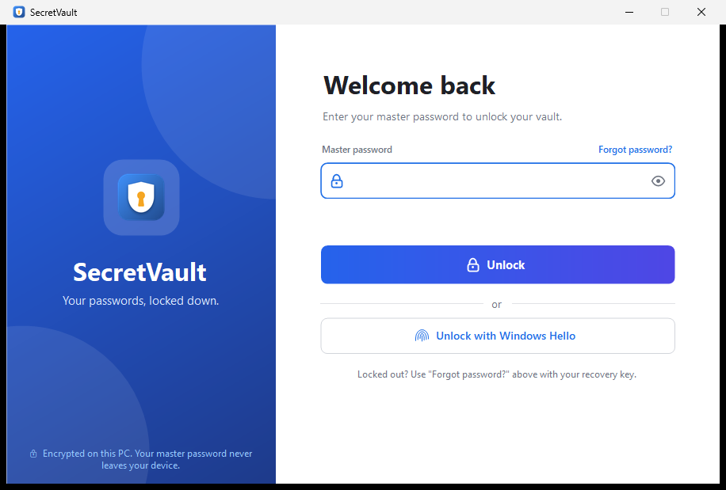 | 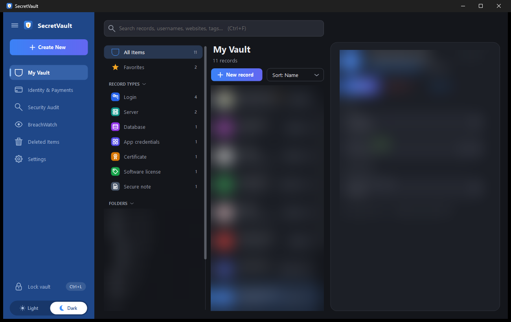 |
| Unlock with password, Windows Hello or recovery key | Dark theme |
| 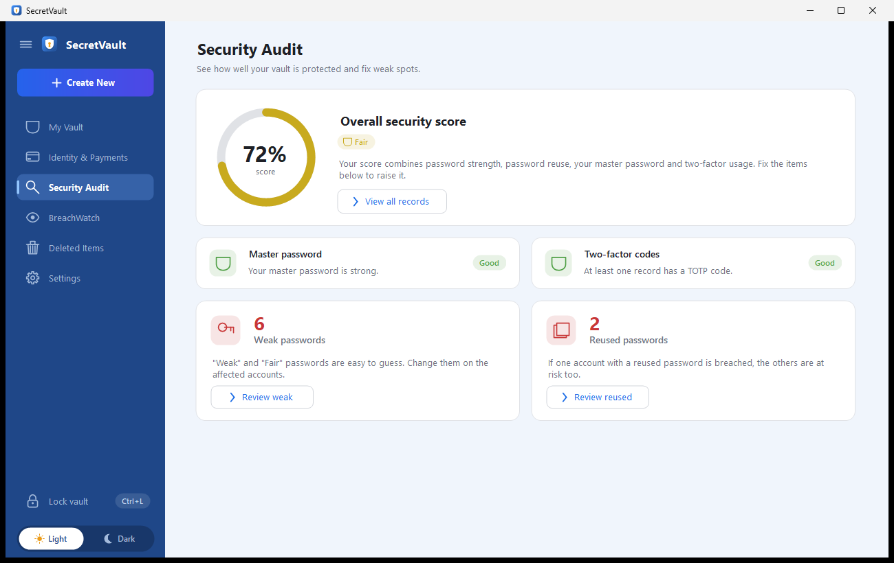 | 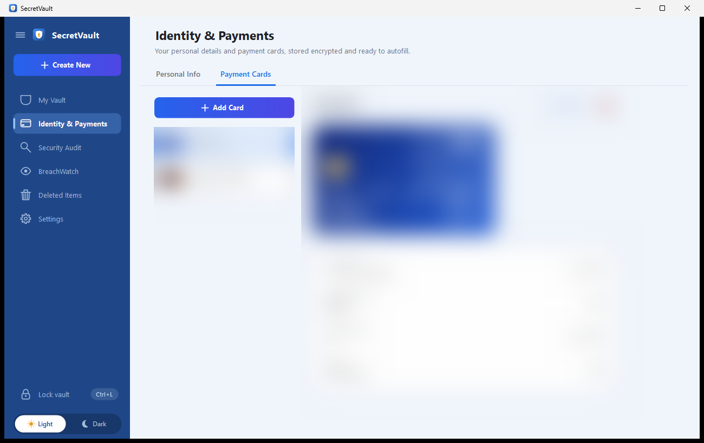 |
| Security Audit | Identity & Payments |
| 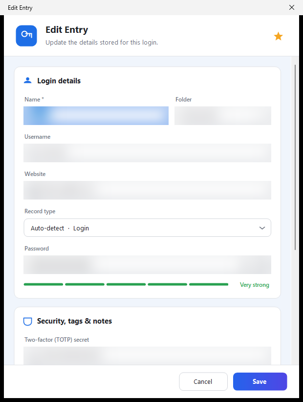 | 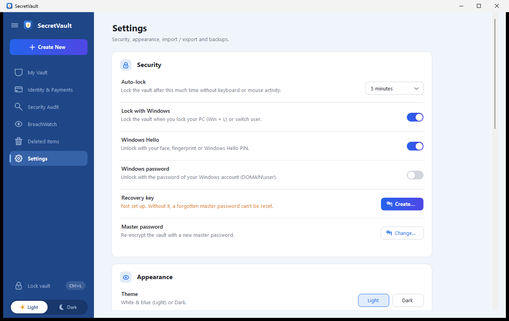 |
| Add / edit a record | Settings |
| 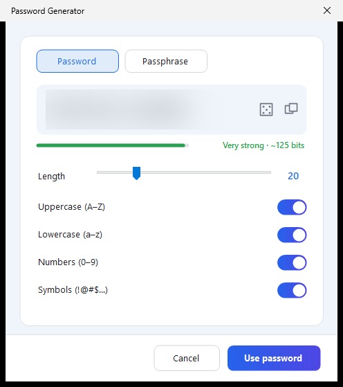 | 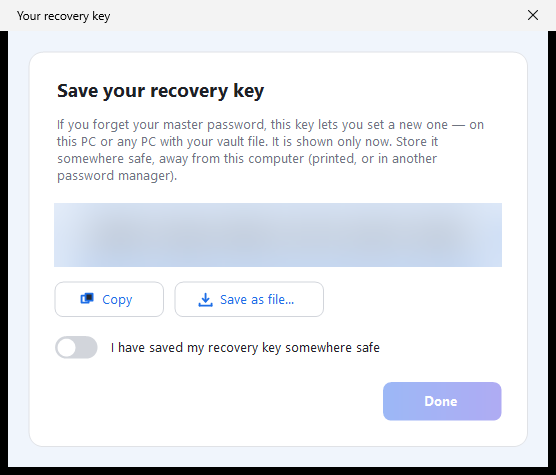 |
| Password generator | Recovery key (shown once) |
| 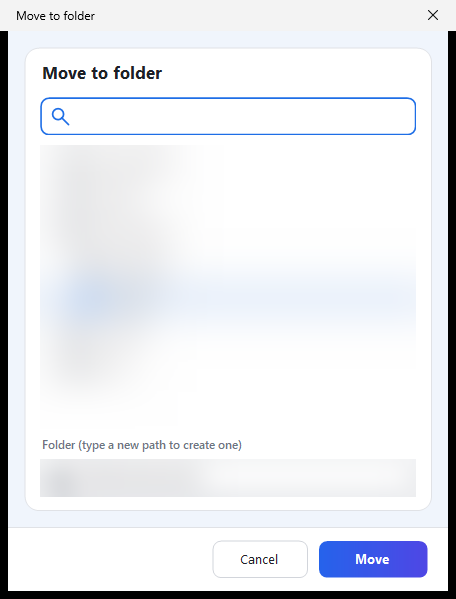 | 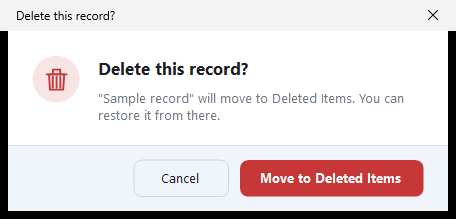 |
| Move a record (searchable folder picker) | Clear confirmation before deleting |

---

## Install

Requires Windows 10 (version 2004) or later and the [.NET 10 SDK](https://dotnet.microsoft.com/download) to build.

```powershell
git clone <repo-url>
cd secret-vault
.\install.ps1            # add -Launch to start it afterwards, -NoDesktopShortcut to skip the desktop icon
```

The script builds a self-contained `SecretVault.exe` into `dist\` (no separate .NET runtime needed — this
single file can be copied to any Windows 10/11 PC and run as is), installs it for
the current user in `%LOCALAPPDATA%\Programs\SecretVault` (no admin rights), adds Start Menu and Desktop
shortcuts, and registers it under **Settings › Apps**.

**Uninstall:** Settings › Apps › SecretVault, or `.\install.ps1 -Uninstall`. Uninstalling never deletes
your vault.

> If PowerShell blocks the script, run it once with
> `powershell -ExecutionPolicy Bypass -File .\install.ps1`.

### First run

1. Create a master password (at least 12 characters) — or unlock your existing vault.
2. **Create a recovery key** when asked (or later in Settings › Security) and store it somewhere safe,
   away from this PC. It is the only way to reset a forgotten master password.
3. Optional: turn on **Windows Hello** in Settings › Security to unlock with your fingerprint or face.

---

## Android app

`dist\SecretVault.apk` has everything the desktop app has: records with folders, record types, tags, custom
fields, one-time codes and password history; add / edit / move / favourite / delete and Deleted Items;
payment cards and personal info; Security Audit and BreachWatch; password generator; recovery key, change
and reset master password; CSV import / export, encrypted backup and restore. It opens on the same login
screen as the desktop app, every time.

| | | | |
|---|---|---|---|
| 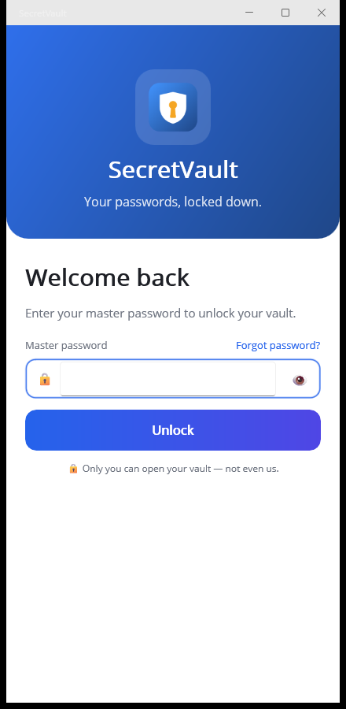 | 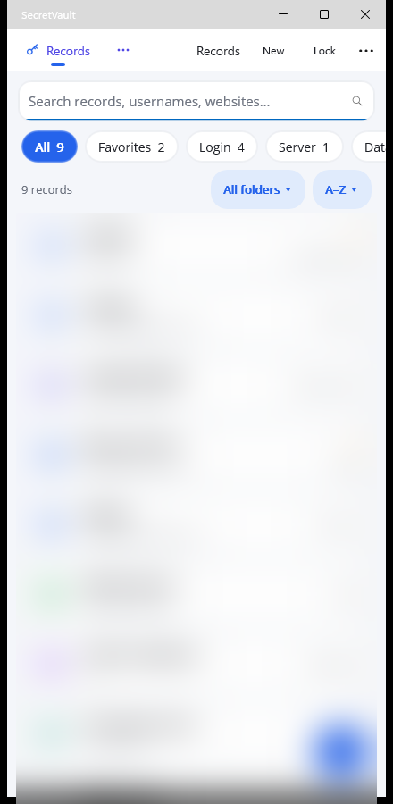 | 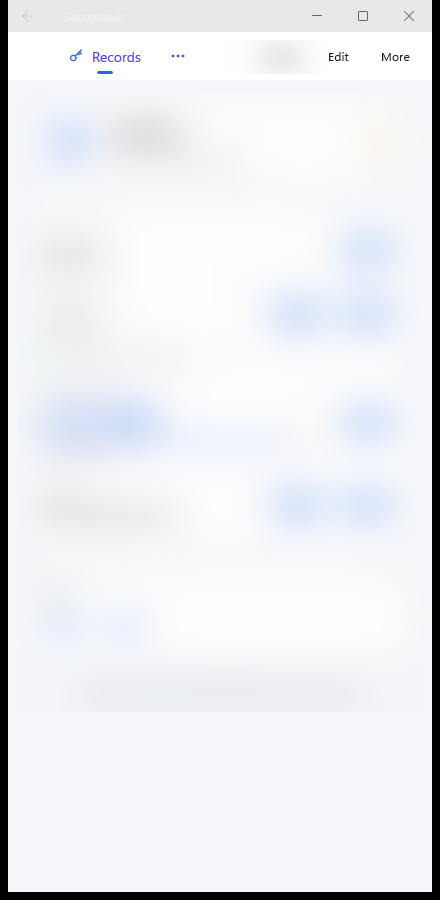 | 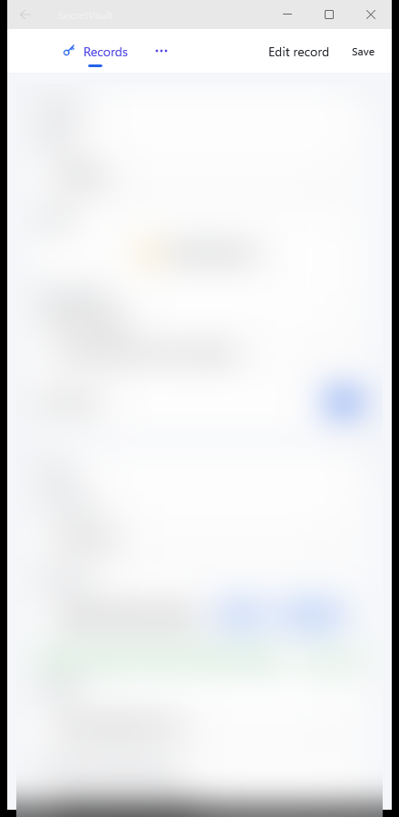 |
| Login (same as desktop) | Records, filters, folders | Record details | Add / edit a record |
| 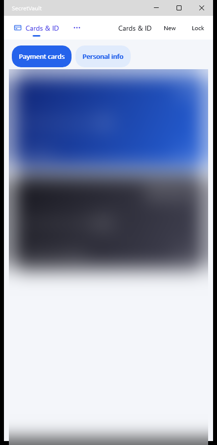 | 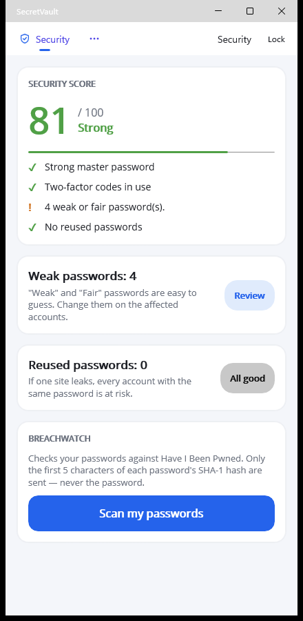 | 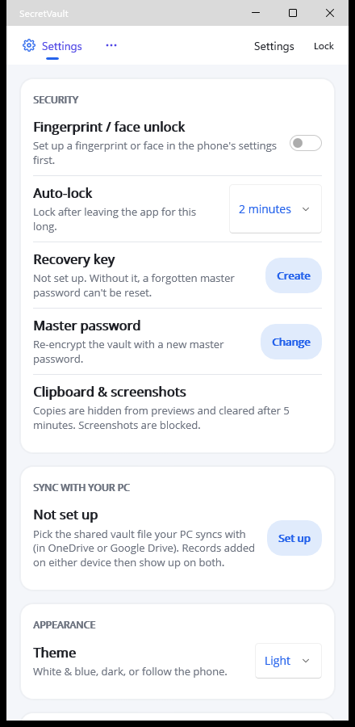 | 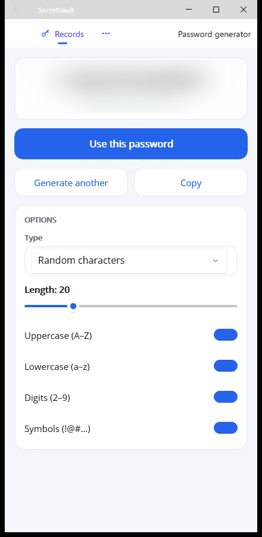 |
| Cards & personal info | Security Audit & BreachWatch | Settings & sync | Password generator |

> Screenshots use sample data with record details blurred.

**Install on your phone** (free, no Play Store):
1. Copy `SecretVault.apk` to the phone (USB, Google Drive, email to yourself…) and open it.
2. Allow "Install unknown apps" for the app you opened it with when Android asks.
3. On the login screen tap **Open my vault from the PC** (see Sync below), or **Create a new vault**.

### Sync between PC and phone

Records added or changed on either device show up on both.

1. **PC:** Settings › **Sync with your phone** › *Set up sync…* — save `SecretVault-sync.db` in your OneDrive
   (or Google Drive) folder.
2. **Phone:** on the login screen tap **Open my vault from the PC**, pick that file in the OneDrive / Drive
   app and choose **Keep in sync** (or later: Settings › Sync with your PC).

Each device keeps its own vault and merges with the shared copy when you open it, after each change and (on
the PC) every 5 minutes. The merge works record by record: additions from both sides are kept, the newer
edit of a record wins, and something deleted forever stays deleted. The shared copy is the normal encrypted
vault file, so the cloud only ever stores ciphertext. If the master password was changed on one device, the
other asks for it once while syncing.

**Security on the phone**
- Same vault file, encryption and code (`SecretVault.Core`) as the desktop app; the vault is decrypted only
  in memory.
- Optional **fingerprint / face unlock**: the master password is encrypted with an Android Keystore key that
  works only after a strong biometric check, and is invalidated if fingerprints / face data change.
- Auto-lock after leaving the app (1–30 minutes, default 2). Copied passwords are marked sensitive and
  cleared after 5 minutes; screenshots are blocked; excluded from cloud backups.
- Internet access is used only by BreachWatch (5 characters of a SHA-1 hash). Sync goes through Android's
  file picker and your Drive / OneDrive app.

Requires Android 9 or later.

---
## Where your data lives

Everything is in `%LOCALAPPDATA%\SecretVault\`:

| File | Contents |
|---|---|
| `vault.db` | Your vault, encrypted |
| `backups\` | Automatic encrypted backups (at most every 30 minutes, last 20 kept) |
| `hello.dat` | Encrypted copy of the master password for Windows Hello (only if enabled) |
| `winpass.dat` | Encrypted copy for Windows-password unlock (only if enabled) |
| `settings.json` | Preferences only (theme, auto-lock, panel layout) — no secrets |

To move to another PC, copy `vault.db`; it opens with your master password or recovery key.

---

## Keyboard shortcuts

| Keys | Action |
|---|---|
| `Ctrl+F` | Search |
| `Ctrl+N` | New record |
| `Ctrl+E` | Edit selected record |
| `Ctrl+C` / `Ctrl+B` | Copy password / username of the selected record |
| `Ctrl+L` | Lock vault |
| `Delete` | Move selected record to Deleted Items |
| Right-click | Record / folder actions |
| `Esc` | Clear search |

---

## How the encryption works

- The records are serialized to JSON and encrypted with **AES-256-GCM** using a random 256-bit *vault key*.
- The vault key is stored in the file twice, each copy encrypted ("wrapped") with a key derived by
  **Argon2id** (64 MB memory, 4 passes, 4 lanes, random salt): once from the **master password** and,
  optionally, once from the **recovery key**. Either can unlock the vault; changing the master password
  only re-wraps the vault key, so the recovery key keeps working.
- The Argon2id settings are stored in the file, so a vault opens on any PC.
- A wrong password or a modified file fails the GCM authentication check (`VaultAuthenticationException`).
- **Windows Hello:** the master password is encrypted with a key derived from a Windows Hello credential
  held in the TPM (usable only after fingerprint / face / PIN), then wrapped with DPAPI for the current user.
- **Windows password:** the master password is encrypted with an Argon2id key derived from the Windows
  account password, then wrapped with DPAPI.
- **BreachWatch** sends only the first 5 characters of each password's SHA-1 hash to Have I Been Pwned.

**File format v2:** `"SVLT"` `02` · Argon2id parameters · master wrap · recovery flag (+ recovery wrap) ·
data nonce · data tag · ciphertext. Version 1 files (key derived directly from the master password) are
still read and are upgraded to v2 on the next save, after a backup.

**Limits:** while the vault is unlocked the master password is held in memory (needed to save changes);
locking clears the window that holds it. Anyone who can pass your Windows Hello check can unlock the
vault if Windows Hello unlock is enabled.

---

## Command line

The CLI uses the same vault file:

```
dotnet run --project SecretVault.Cli -- <command> [args]
```

```
vault init                                     Create a new vault
vault add <name> [--folder <f>] [--generate [length]]
vault get <name> [--show]                      Copy secret to clipboard (or print with --show)
vault list [folder]                            List entries, optionally filtered by folder
vault search <term>                            Search entries
vault remove <name>                            Delete an entry
vault generate [length] [--no-symbols]         Print a random password without saving it
vault totp <name>                              Show the current TOTP code
vault totp-set <name> <secret>                 Attach/update a TOTP secret
vault field-set <name> <label> <value> [--secret]
vault field-get <name> <label>
vault path                                     Show the vault file location
```

The CLI does not yet show newer fields (website, tags, record type) or manage recovery keys.

---

## Development

```
dotnet build SecretVault.slnx
dotnet run --project SecretVault
dotnet test SecretVault.Tests
```

| Project | Contents |
|---|---|
| `SecretVault.Core` | Models, encryption (`VaultCrypto`), vault file format and backups (`FileVaultStore`), recovery keys, password generator and strength, TOTP, breach checker, CSV import/export, record types |
| `SecretVault` | WinForms desktop app (`net10.0-windows10.0.19041.0`) |
| `SecretVault.Cli` | Command-line front end |
| `SecretVault.Mobile` | Android app (.NET MAUI), full feature set + sync, shares `SecretVault.Core`; also builds for Windows to test the screens |
| `SecretVault.Tests` | xUnit tests: vault format and upgrades, recovery keys, wrong passwords and tampering, backups, imports (Keeper / Chrome / Bitwarden), generator, record types, card brands, UI smoke tests, and one live BreachWatch check (`[Trait("Category", "Network")]`; skip with `--filter Category!=Network`) |

Tests never touch your real vault: storage tests use temporary files, and UI tests back up and restore
`settings.json`.

The app's ready-to-share build is `dist\SecretVault.exe` (created by `install.ps1`).

**Building the Android app** needs the MAUI Android workload, JDK 17 and the Android SDK. Without them,
build the desktop projects individually instead of the whole solution.

```powershell
dotnet workload install maui-android
# JDK 17 into %LOCALAPPDATA%\Android\jdk-17 (https://aka.ms/download-jdk/microsoft-jdk-17-windows-x64.zip), then:
dotnet build SecretVault.Mobile -t:InstallAndroidDependencies -f net10.0-android -p:AcceptAndroidSDKLicenses=True `
  -p:AndroidSdkDirectory=$env:LOCALAPPDATA\Android\Sdk -p:JavaSdkDirectory=$env:LOCALAPPDATA\Android\jdk-17
dotnet publish SecretVault.Mobile -c Release -f net10.0-android
copy SecretVault.Mobile\bin\Release\net10.0-android\publish\com.secretvault.mobile-Signed.apk dist\SecretVault.apk
```

The APK is signed with this PC's .NET debug key (`%LOCALAPPDATA%\Xamarin\Mono for Android\debug.keystore`).
Keep that file: Android installs an update over the old app only when it is signed with the same key.
